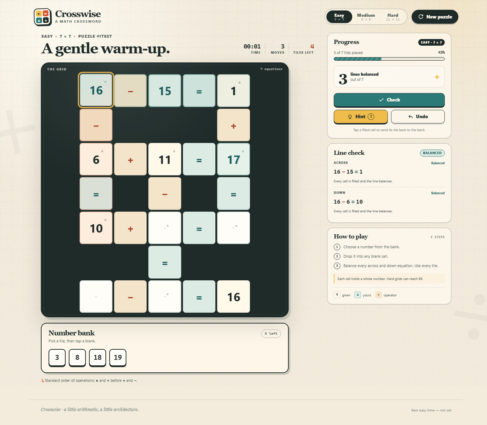

# Crosswise

A math crossword that builds itself. Every puzzle is a small lattice of
interlocking equations. Each cell holds a whole number — up to 99 at the
hardest level — and you fill the blanks from the number bank so that every
across and down line balances.



## Play

Open `index.html` in a modern browser. There is no build step, no server, and
no dependency to install — the game runs straight from the file system.

If your browser is strict about `file://` pages, serve the folder instead:

```powershell
python -m http.server 8080
# then open http://localhost:8080
```

## Rules

- Operators, equals signs, and some whole numbers are already on the grid.
- The bank contains exactly the numbers needed to fill every blank cell.
- Pick a tile and tap a blank cell, or drag the tile onto it.
- Tap a filled cell to return its number to the bank, or drop a different tile
  onto it to replace it.
- Every across and down equation must resolve correctly, and every tile must
  be used.
- Equations use standard order of operations: `×` and `÷` before `+` and `−`.
- Keyboard: arrow keys move between cells, Enter places the selected tile, and
  Backspace/Delete clears the focused cell.
- Any valid arrangement wins. The puzzle does not require a specific solution
  layout, only balanced lines and a full grid.

The side panel inspects the two lines that cross the selected cell, including
live balance status. **Check** marks completed lines that do not balance.
**Hint** places one correct number (a limited number per puzzle). **Undo** rolls
back placements, replacements, clears, and hints.

## Difficulty

| Level | Grid | Equations | Cell values | Operations | Style |
| --- | --- | --- | --- | --- | --- |
| Easy | 7 × 7 | 6–7 | 0–20 | `+`, `−` | Two-number warm-ups |
| Medium | 9 × 9 | 8–10 | 0–80 | `+`, `−`, `×` | Two- and three-number chains |
| Hard | 11 × 11 | 10–12 | 0–99 | all four | Two/three-number equations with division |

Larger grids mean more crossings, longer lines, and more hidden numbers.
Division is restricted to whole-number steps, so every equation stays friendly
to mental arithmetic.

## How puzzles are made

1. Build a pool of valid whole-number equations for the selected difficulty,
   filtering for integer results, sensible operand sizes, and 5- or 7-cell
   equations.
2. Grow a crossword-style lattice one equation at a time. A new equation must
   cross an existing number cell; every run of cells must remain exactly one
   intentional equation.
3. Choose hidden numbers while preserving at least one blank and at least one
   anchor number in every equation. The hidden numbers become the bank.
4. Verify the finished solution and keep a solved reference state used only for
   hints.

The layout is generated from a seed. That seed is written to the URL, so a
puzzle is reproducible and shareable:

```
index.html?level=medium&seed=MYSEED
```

## Project layout

```
math-crossword/
├── index.html              page shell
├── styles.css              visual design and responsive layout
├── package.json            test scripts
├── assets/
│   ├── favicon.svg
│   └── preview.png
├── src/
│   ├── equations.js        rational arithmetic + equation checking
│   ├── generator.js        equation pools, lattice growth, givens, tiles
│   └── app.js              game state, DOM, interaction, timer, win flow
└── tests/
    ├── generator.test.js   evaluator + multi-seed generator audit
    └── browser.test.js     Edge/CDP smoke test + full playthrough
```

## Development

The source is plain browser JavaScript with no bundler, framework, or runtime
dependency. Edit the files and refresh.

Run the generator and equation suite:

```powershell
node tests/generator.test.js
```

Run the browser test (requires Node 22+ and Microsoft Edge; uses the DevTools
Protocol and no npm packages):

```powershell
node tests/browser.test.js
```

The browser test loads a deterministic easy puzzle, checks the inspector,
verifies wrong-line checking and hint/undo, solves the puzzle through the UI,
checks the win state, switches to medium, and verifies the 11 × 11 board at
390 px and 320 px viewports. Screenshots are written to `tests/screenshots/`.
## Notes

- Cell values range from 0–20 on Easy up to 0–99 on Hard; operators and equals
  signs are fixed cells.
- The timer and best time are stored in `localStorage` under `crosswise.v2`.
- Best times are kept per difficulty.
- The board and bank are intentionally generated at runtime; no puzzle data is
  hard-coded.
- Puzzles may have more than one valid fill. That is allowed by design: the
  goal is a correct, complete grid, not a memorized solution.
